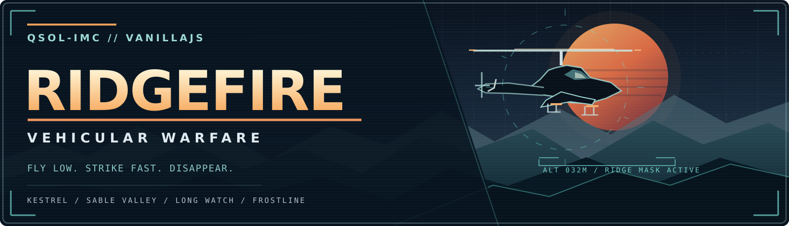

Choose **Combined arms** on the mission board to fly, drive, walk or sail in Breakwater Reach. Standalone sorties include the three Kestrel helicopter missions, Cutbank Relay, Glassworks Crossing and Lantern Sound.

| Sortie | Opponents | Objective |
| --- | ---: | --- |
| Sable Valley | 2 | Learn terrain masking in the original quick encounter. |
| Long Watch | 9 | Clear four relay sites and hold inside each beacon for three seconds. |
| Frostline Run | 15 | Clear six patrols and fly low through the crossings in order. |

The long sorties launch in cockpit view. Its north-up route display shows the aircraft, the active beacon, and ground contacts that currently see you. Warm tracers and an **Incoming fire** warning follow live enemy rounds. Diamonds beside the target name show remaining hits, and a hull-hit notice confirms damage. Frostline has snow-covered slopes and pale morning light. Long Watch takes place at dusk.

Long Watch and Frostline use a 960 m valley. Follow the distance and compass bearing on the HUD. Once a patrol is cleared, enter the teal circle below 34 m above ground. Each confirmed beacon repairs up to 32 hull points and refills the rocket pods. Return to **Mission board** from pause or the debrief to choose another sortie.

## One-handed vehicle controls

Tanks, mechs and ships start with **Simple** controls in their own missions, Combined arms and workshop playtests. **W/S** move forward or back, **A/D** turn the vehicle and bring its mount around, and **Space** fires. Release the tank’s drive keys to brake. The walker finishes its stride. A slow cutter applies a little ahead power when you steer so the rudder can turn it.

To aim independently with your left hand, use **Q/E** for left/right and **R/F** to raise/lower. Your aim holds when you release those keys. The next steering turn resumes mount following. Arrow keys and captured mouse also control the mount. Choose **Independent** in the briefing or pause panel for separate steering and aiming throughout. The browser remembers your choice for all three surface crews. In the helicopter, E/Q still control lift and Z/X still slide sideways.

## Ground sortie · Cutbank Relay

Open the ground sortie from the mission board to drive a tracked vehicle against a CPU guard. **W/S** drive the tracks forward or backward, **A/D** steer, and **Shift** brakes. To stop on the shelf with Simple controls, release W and keep holding Space. **Space** fires, **C** changes the camera and **P** pauses. The ground sortie has its own replay checker and a return link to the helicopter board. [Tank authority and limitations](docs/TRACKED_WARFARE.md) · [Mission runs and screenshots](evidence/tracked-warfare/)

## Walking sortie · Glassworks Crossing

Pilot a six-legged walker across the terraces, disable the sentinel and reach the survey beacon. **W/S** walk forward or backward and **A/D** turn the legs. In Simple controls the torso follows the turn. **Space** fires, **C** changes the camera, and **P** pauses. The mech page includes local sound, a replay download and a checker for saved Glassworks runs. [Walking and combat contract](docs/MECH_WARFARE.md) · [Chromium playthrough and measurements](evidence/mech-warfare/)

## Naval sortie · Lantern Sound

Choose **Naval sortie** to pilot a cutter through the island channel. **W/S** apply forward or reverse thrust. **A/D** turn the rudder. Simple controls supply headway for low-speed turns and bring the deck mount around. **Space** fires, **C** switches views and **P** pauses. Disable the patrol and shore relay, then sail into the exit buoy. [Vessel, water and replay contract](docs/NAVAL_WARFARE.md) · [Playthrough, screenshots and measurements](evidence/naval-warfare/)

## Combined arms · Breakwater Reach

Choose a helicopter, tank, mech or ship before deploying. Your other three crews join you against four mobile defenders and a shore relay. Disable the relay to open your crew's gate, enter the gate and help the team disable two mobile defenders. Holding the gate lets your crew draw on its limited repair supply. The briefing lists controls for each vehicle, and the debrief lets you save the run or choose another crew. [Theatre, vehicle and replay API](docs/COMBINED_ARMS.md) · [Playthroughs and measurements](evidence/combined-arms/)

Choose **FX gate beacon** to mark your capture gate with a rotating faceted light. Press **G** to switch between it and the original gate lamps during play. Workshop playtests and replays also support the marker. [FX-PIPE geometry and controls](docs/FX_PIPE.md)

Select **Retro Tactical Display** in the mixed briefing, pause panel or workshop, or press **M** in a live mixed sortie to switch the map. Its four crew palettes use distinct symbols for the player, allies, visible enemies and the gate. The modern chart is the default. [Retro display and visibility rules](docs/RETRO_DISPLAY.md)

Choose **War Room** on the mission board to command all four Cobalt crews from the strategic map. Drag a box around several crews and right-click terrain to move or a visible contact to attack. Shift + right-click queues the next order. The roster and coordinate form provide the same commands. Press **F** to follow a selected crew in 3D and use **Return to map** to keep commanding. Save a replay from pause or debrief and open it on the War Room briefing. [War Room controls and mission](docs/WAR_ROOM.md)

Choose **Formation command** to route crews around charted obstacles and give a group of vehicles separate destinations. [Formation slots and routing](docs/FORMATION.md)

Choose **Battle Director** in the observation camera selector to orbit a friendly crew. From pause or a verified replay, **Inspect frame** lets you change the camera at the held tick. [Director controls](docs/WAR_ROOM.md)

Choose **The Big Battle · 24 vehicles** to command twelve Cobalt crews against twelve Ember crews on the same coastal board. Each numbered section has a helicopter, tank, walker and cutter. [Big Battle roster and limits](docs/BIG_BATTLE.md)

Choose **Operation Overlord · Tactical Intelligence** to assign doctrines and section tasks to twelve crews. Open **Decision inspector** for a selected crew or **Subject decision** in Battle Director. Dashed rings on the chart mark last-known positions. [Operation controls and replay](docs/OVERLORD.md)

The [command-mode numerical API](docs/COMMAND_AUTHORITY.md) lets four independently ordered crews share this battlefield. Its versioned receipt records group orders and waypoints.

## Creator systems · Mission workshop

Choose **Mission workshop** on the mission board. Give the mission a title, set its terrain seed and player crew, then place the gate and shore relay on the chart. You can click a landmark into place, use the arrow keys on the chart, or enter coordinates. **Apply changes** saves the accepted draft in this browser. **Export pack** creates a small JSON file that another player can import and play offline.

After a playtest, choose **Watch replay** or **Save replay**. The workshop also opens saved Breakwater Reach recordings. Pause, scrub to a tick, then switch between chase, gun sight and overhead to see the same moment from three angles. **Music** enables an original local score that follows the encounter in both live play and replay. [Pack format and replay API](docs/CREATOR_SYSTEMS.md) · [Playable example, score and verification](evidence/creator-systems/)

## Terrain view

Choose **Original WebGL** or **Experimental voxel** on the mission board or pause panel. In flight, press **T** or use the terrain button to switch at the current aircraft pose. Survey uses a 256 × 160 working image. Fine uses 384 × 240. Both use WebGL1 for the sky, 3D objects and final composition.

The voxel view colours the visible face of each ridge with stepped spans. The sight, hull and rocket impacts still use the sortie’s accepted terrain. A low-resolution silhouette can differ by several pixels from the edge that actually blocks a target. See the [renderer contract](docs/ARCHITECTURE.md#terrain-views) and [Chromium comparison](evidence/voxel-terrain/).

## Launch locally

From the repository root, run the following command with Python 3.

```sh
python3 -m http.server 8080 --bind 127.0.0.1
```

Open [RIDGEFIRE on localhost](http://127.0.0.1:8080/) in desktop Chromium with WebGL enabled, then select **Launch mission**. All executable code, geometry and shaders are local. The same files can be served below a directory prefix.

| Control | Action |
| --- | --- |
| W / S | Fly forward / backward. |
| A / D | Turn left / right. |
| E / Q | Climb / descend. Release to settle into hover. |
| Z / X | Slide left / right while keeping your heading. |
| Up / down arrows | Adjust sight elevation. |
| Space or left mouse | Launch a rocket. Hold for repeated fire. |
| Right mouse | Capture mouse steering and sight elevation. Escape releases capture and pauses. |
| V | Toggle the 1.6× cockpit sight. |
| C | Switch between chase and cockpit cameras. |
| P or Escape | Pause. Resume, restart or save a replay from the panel. |

The original R/F lift keys and left/right arrow turning also work.

In Sable Valley, begin in cover and tap Space to see a rocket hit the ridge. Hold E until the threat indicator reads **EXPOSED**, then release. A named reticle identifies a visible target inside the assisted sight cone. Rockets fly straight from launch. Hold Q briefly to break contact. The defenders search the last observed position while their airborne shots continue. A hard descent can destroy the aircraft. The mission ends on destruction of both targets, loss of the Kestrel, exhaustion of usable rockets, or the three-minute time limit.

## Release candidate

Build the offline game from a committed checkout with `python3 tools/package.py /tmp/Vehicular-Warfare.zip`. Unzip it, run the local server from the extracted Vehicular-Warfare directory and open the mission board. PR verification exercises the controls against this packaged runtime. Mixed battles use distance-based vehicle detail and bounded effects. [Offline play and owner review](docs/RELEASE.md) · [Native and software measurements](evidence/release-performance/)

## Verification

The separately tested authority runs at 120 Hz. Run the numerical tests with Node 22 and Python 3. The browser acceptance driver starts an ephemeral loopback server and an isolated headless Chromium profile, flies via keyboard and mouse, captures screenshots and writes raw measurements to the chosen directory.

```sh
node --test test/*.test.js
node tools/measure.mjs
node tools/measure.mjs mech
node tools/measure.mjs naval
node tools/measure.mjs combined
node tools/measure.mjs creator
CHROMIUM=google-chrome node tools/browser.mjs /tmp/ridgefire-verification
CHROMIUM=google-chrome node tools/browser.mjs /tmp/ridgefire-routes routes
CHROMIUM=google-chrome node tools/browser.mjs /tmp/ridgefire-columns terrain
CHROMIUM=google-chrome node tools/browser.mjs /tmp/ridgefire-tracked tank
CHROMIUM=google-chrome node tools/browser.mjs /tmp/ridgefire-walking mech
CHROMIUM=google-chrome node tools/browser.mjs /tmp/ridgefire-sailing naval
CHROMIUM=google-chrome node tools/browser.mjs /tmp/ridgefire-combined combined
CHROMIUM=google-chrome node tools/browser.mjs /tmp/ridgefire-workshop creator
```

**Save replay** downloads the seed, accepted control changes, elapsed ticks, source identity and state/event checksums. Open **Flight controls & saved replays → Check saved flight** to verify the file locally in the recording browser. The report shows sortie, elapsed time and outcome. Node can verify a receipt when its runtime reproduces the checksums. From the repository root, run

```sh
node --input-type=module -e "import {readFileSync} from 'node:fs'; import {replay} from './sim/world.js'; console.log(replay(readFileSync(process.argv[1],'utf8')).status)" ridgefire-replay.json
```

The [numerical evidence](evidence/authority/) records eight passing tests at `91eb991ba861a772fe616ee0ae5b16179b4c8836`. [PR #2](https://github.com/QSOLKCB/Vehicular-Warfare/pull/2) merged that authority and its evidence into main at `3e37e8b66d998f083b5f1872c9531b5b25a53d8d`. See the [simulation contract](docs/AUTHORITY.md) for replay scope, sweep geometry and sensor timers.

### Mission playthroughs

The mission acceptance flights completed Long Watch in 71 seconds and Frostline Run in 79 seconds using keyboard controls in Chromium. The ground units launched 12 and 18 projectiles respectively. Those times measure a rehearsed route. Both receipts reproduced in the recording Chromium runtime. Node on this machine produced different checksums for those long browser recordings. Use the in-game checker for browser saves. [Mission receipts and screenshots](evidence/valley-missions/)

The cockpit pass repeated both routes at 1.6× sight zoom with sound enabled and recorded an exposed-hover defeat. The [cockpit evidence](evidence/cockpit-polish/) includes screenshots, replay receipts, and the accepted impacts on the aircraft.

### Original Sable Valley benchmark

At `a0ad1738085d3bb9bbdfe1b83238028003d484eb`, Chrome 158.0.8127.36 completed the mission through keyboard and mouse input. AA first fired on its 120th consecutive visible tick. A player rocket damaged the moving convoy, descent broke AA sight, and the player reappeared to finish both objectives. A separate exposed hover ended in destruction by enemy fire. Both exported command traces reproduced their recorded state and event checksums in Node. The [raw browser report](evidence/browser/playthrough.json) includes commands, events, frame and tick samples, debugger heap measurements and teardown observations.

| Run | Accepted ticks | State checksum | Event checksum |
| --- | ---: | --- | --- |
| Victory | 1,036 | `4c7c7425` | `44e841ed` |
| Defeat | 763 | `8c57c19c` | `24b0cc00` |

[Concealed](evidence/browser/02-masked.png) · [Exposed](evidence/browser/03-exposed.png) · [Retreat](evidence/browser/04-search.png) · [Cockpit](evidence/browser/05-cockpit.png) · [Victory](evidence/browser/06-victory.png) · [Defeat](evidence/browser/07-defeat.png)

The Linux run used an AMD Ryzen 9 5950X and ANGLE Vulkan SwiftShader software rendering at 1100 × 720. The winning run recorded 496 frame intervals, with p50 16.7 ms and p95 16.8 ms. The concealed chase frame submitted 45,255 vertices in six draws. Three actors and at most six projectiles were active in the winning run. The independent Node trace measured 26 µs median and 99 µs p95 per tick. Browser tick timings include zero-duration samples at the browser clock's resolution.

Pause, pointer unlock and switching to another foreground tab stopped the simulation. The driver also dispatched isolated blur and hidden-state notifications. Across four sampled teardowns, the renderer reported zero owned mesh buffers, the flight session had no scheduled frame, and Chrome counted nine page-level listeners after garbage collection. These short-run measurements leave long-session memory growth and physical GPU performance unverified. Every observed game request stayed under the loopback subpath. The WebGL-unavailable message was exercised by denying context creation on reload.

## Source and scope

VANILLAJS v3.5.0 is pinned at `9d95d74b355ec17add32db0b55f0f71130f9c004`. The [per-file SHA-256 manifest](vendor/vanillajs/provenance.json), [upstream license](vendor/vanillajs/LICENSE) and [notice](vendor/vanillajs/NOTICE) accompany the exact source closure. Reproduce this branch's closure with `python3 tools/vendor.py /path/to/VANILLAJS`. The renderer retains the landscape and sky and reuses model and effect buffers. Aircraft motion, targeting and mission outcomes come entirely from the numerical world.

The Kestrel flies three seeded missions. The hull uses conservative terrain clearance and assisted lift. Enable **Sound** in flight for the local rotor, launch, impact and beacon tones. Pause and debrief close the audio context. Keyboard-only flight works without mouse capture. Replay is scoped to the tested runtime. The release performance checks cover the mixed theatre on one physical NVIDIA GPU. Mobile touch flight controls remain unverified.

[Agent instructions](AGENTS.md) · [Roadmap](ROADMAP.md) · [Original handoff](docs/CODEX_CLI_HANDOFF.md) · [Game design](docs/GAME_DESIGN.md) · [Architecture](docs/ARCHITECTURE.md) · [Engine baseline](docs/ENGINE_BASELINE.md) · [DOS-era techniques](docs/DOS_TECHNIQUES.md) · [Acceptance contract](docs/ACCEPTANCE.md)
