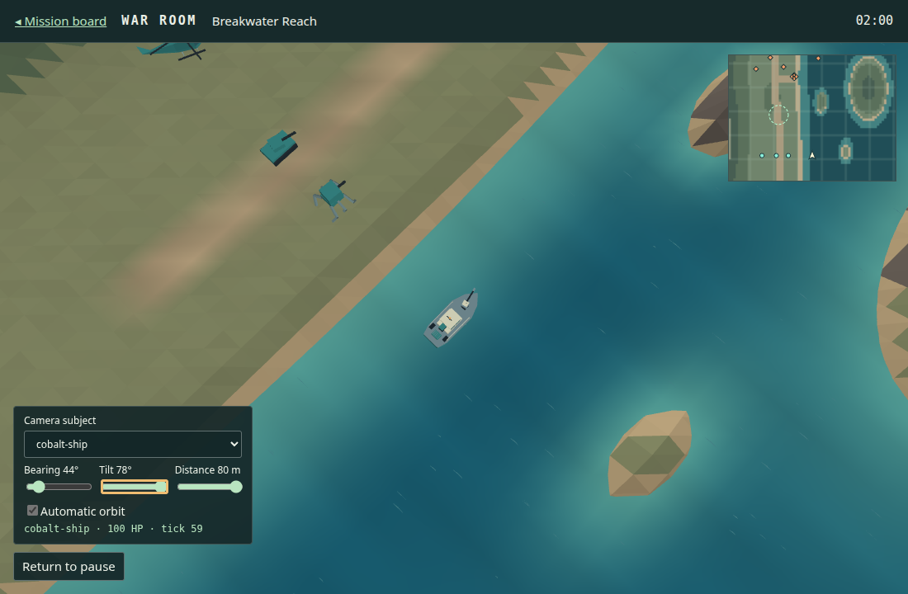

# Battle Director acceptance

Tested gameplay, UI and driver at `52c09e9cb040ba54c4974581fcb8e42c12f0696f`. The numerical suite passed 133 tests. The camera tests cover subject loss, world bounds, terrain and water clearance and orbit angle against the fixed simulation clock.

Both packaged Chromium runs selected four crews, pinned the cutter independently of that selection, enabled automatic orbit, paused and changed the camera range and elevation while holding the simulation tick. The camera eye changed while the complete receipt stayed equal. Inspecting a verified v0.4.0 replay restored its tick-1,325 state and event digests. GPU context loss, restoration and blur ended with zero owned mesh buffers.

The live reports include scene submission samples, draw calls and frame intervals during the camera transition. These short traces include construction of the first view. They describe this interaction only. The director is an observation camera. Vehicle orders remain with the War Room.

Run `python3 tools/identity.py --check` and `node --test test/*.test.js` at the tested revision. Package and extract the offline ZIP with `tools/package.py` and Python's zipfile module. Set RIDGEFIRE_WEB_ROOT to the extracted Vehicular-Warfare directory and run `node tools/browser.mjs /tmp/director-check director` with CHROMIUM_BACKEND set to native or software.

[Controls](../../docs/WAR_ROOM.md) · [Runtime identities and archive SHA-256](provenance.json) · [Native run](native.json.gz) · [SwiftShader run](software.json.gz)

