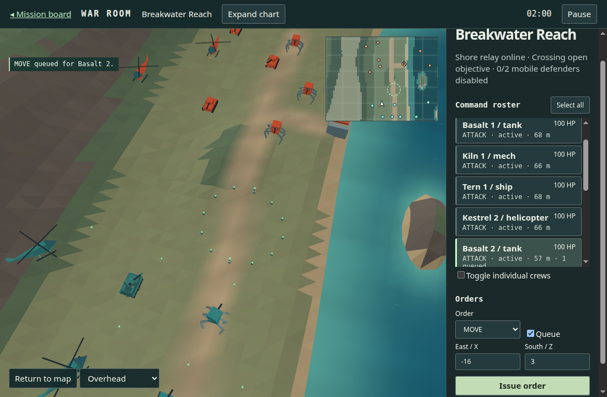

# The Big Battle acceptance

The [tested offline ZIP](Vehicular-Warfare.zip) contains the game at `4c45f35e6092c8b7d4ebd8a1a0d1477338254b75`. SHA-256 is `bc78130b0a243e89bc9160a0199ebdaafe040d3d58b525d2f7a6aa219178ae52`. Extract the ZIP, serve the Vehicular-Warfare directory with `python3 -m http.server 8080 --bind 127.0.0.1`, open localhost port 8080 and choose **The Big Battle · 24 vehicles**.

All 137 numerical tests passed. Tests cover three sections per side on multiple seeds, distinct unit IDs and slots, walker foot and cutter contact, replay validation and capacity for 24 distant silhouettes, six wakes and 54 full-detail shadow discs. The combat ledger retains its 32-projectile cap.

Both Chromium runs launched the extracted game from the mission board, selected all twelve Cobalt crews, issued an attack on the observed relay, and queued a crossing move for Basalt 2. The renderer submitted all 24 mobile crews and the relay in the recorded observation sample. The tank physically travelled to the crossing. Each run saved its victory receipt through the debrief and reproduced it through the file input. The runs admitted UI actions at different ticks.

| Browser renderer | Victory tick | State digest | Event digest |
| --- | ---: | --- | --- |
| RTX 5060 Ti | 648 | `17f59443` | `36df0332` |
| SwiftShader | 654 | `c25b0e33` | `5f305ac6` |

In a separate twelve-crew movement test, seven crews reached their assigned slots by tick 2,000. Two were disabled before arrival and three were still on approach. Some arrivals were subsequently disabled. The tests establish a playable 24-vehicle scenario on the measured coast. [Scale measurements and limitations](PERFORMANCE.md)

Six SwiftShader regression suites exercised the same extracted ZIP. The classic War Room reproduced a victory at tick 1,325, the formation cutter arrived at tick 2,386, and the archive verifier replayed 107 distinct recordings from 204 occurrences. The Director, Breakwater crew missions and Mission Workshop also passed. [Regression results and raw browser reports](regression/summary.json)

## Reproduce

~~~sh
out=$(mktemp -d)
python3 tools/identity.py --check
node --test test/*.test.js
node tools/big-battle-measure.mjs
python3 tools/package.py "$out/game.zip"
python3 -m zipfile -e "$out/game.zip" "$out/unpacked"
export RIDGEFIRE_WEB_ROOT="$out/unpacked/Vehicular-Warfare"
CHROMIUM_BACKEND=native node tools/browser.mjs "$out/native" big-battle
CHROMIUM_BACKEND=software node tools/browser.mjs "$out/software" big-battle
for suite in war-room formation director archives combined creator; do
  CHROMIUM_BACKEND=software node tools/browser.mjs "$out/regression/$suite" "$suite"
done
~~~

[Source and package provenance](provenance.json) · [Numerical samples](measure.json.gz) · [Native run](native.json.gz) · [Software run](software.json.gz) · [Roster and controls](../../docs/BIG_BATTLE.md)

