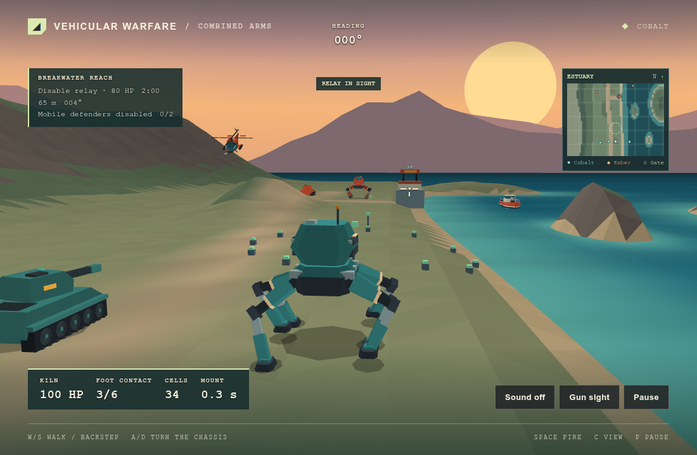

# VW-005 · Breakwater Reach acceptance

All runs in this directory used gameplay and drivers at `5af96674108ab08909ca0ad6b4c4333cc6304722`, based on reviewed naval merge `32917d00456a9e6a1e22b85e8dcb2563630bc5d4`. The following commit archives the results. The main mission uses seed 2505.



## Play and reproduce

Run `python3 -m http.server 8080 --bind 127.0.0.1` from the repository root. Choose **Combined arms**, select a crew, then choose **Deploy**. For the recorded route, advance with W while holding Space. After capturing the gate, release W and keep firing. Hold Shift to brake the tank. To reproduce the loss, advance the helicopter with W alone. P pauses and C switches cameras. The debrief lets you restart, select another crew, download a replay or check it locally. [Mission board](../../index.html) · [Controls and simulation contract](../../docs/COMBINED_ARMS.md)

```sh
output=$(mktemp -d)
python3 tools/identity.py --check
node --test test/*.test.js
node tools/measure.mjs > "$output/flight-measure.json"
node tools/measure.mjs combined > "$output/mixed-measure.json"
CHROMIUM=google-chrome node tools/browser.mjs "$output/combined" combined
CHROMIUM=google-chrome node tools/browser.mjs "$output/sable"
CHROMIUM=google-chrome node tools/browser.mjs "$output/routes" routes
CHROMIUM=google-chrome node tools/browser.mjs "$output/terrain" terrain
CHROMIUM=google-chrome node tools/browser.mjs "$output/tank" tank
CHROMIUM=google-chrome node tools/browser.mjs "$output/mech" mech
CHROMIUM=google-chrome node tools/browser.mjs "$output/naval" naval
```

## What happened in Chromium

The shared battlefield started with four vehicles per faction and an armed shore relay. All four selected vehicles damaged opponents with travelling cells, entered their own gate and survived to victory. Each team victory scored 350. In the fifth run, the unfired helicopter was destroyed at tick 1,064. The five files below were downloaded through the debrief, reimported through the file chooser and verified in Chromium. Replays include the selected crew. Their cryptographic file hashes appear in the [SHA-256 manifest](SHA256SUMS).

| Player | Gate first observed at tick | End tick | HP | State digest | Event digest | Download and screenshot |
| --- | ---: | ---: | ---: | --- | --- | --- |
| Kestrel helicopter | 413 | 1,095 | 20 | `6f78a72e` | `ea239b93` | [Replay](helicopter-replay.json) · [Victory](03-helicopter-victory.png) |
| Basalt tank | 369 | 1,149 | 70 | `167150e6` | `ce10fecb` | [Replay](tank-replay.json) · [Victory](03-tank-victory.png) |
| Kiln walker | 399 | 820 | 100 | `d44c889d` | `a64b561f` | [Replay](mech-replay.json) · [Victory](03-mech-victory.png) |
| Tern cutter | 555 | 978 | 80 | `c1646c7d` | `d8d63dc5` | [Replay](ship-replay.json) · [Victory](03-ship-victory.png) |
| Kestrel helicopter, defeat | — | 1,064 | 0 | `b7d618f4` | `3672444c` | [Replay](defeat-replay.json) · [Defeat](04-defeat.png) |

The browser entered from the mission board under `/ridgefire/`, selected each crew, exercised collective, camera and firing controls, enabled synthesized audio, paused, restarted and changed tabs. It checked keyboard pause, blur, hidden state and real pointer unlock. The clock stopped and the station released input, mesh buffers, audio, session listeners and animation frames. Denying WebGL on reload displayed the error panel. All requests stayed on the local origin and the driver recorded zero runtime errors. [Browser report](combined.json) · [Briefing](01-breakwater-briefing.png) · [Helicopter](02-helicopter-underway.png) · [Tank](02-tank-underway.png) · [Walker](02-mech-underway.png) · [Cutter](02-ship-underway.png)

## Shared contact and replay

All 76 Node tests passed. The mixed-world fixtures exercised physical launches in six directions, moving body contact, range and reacquisition, island and water interception, friendly obstruction and tick ordering. A regression covers a cell starting inside a turning cutter's shrinking projected hull. The tests also ran each complete mission at 30, 60 and 144 presentation updates per second and compared its accepted commands, terminal state and ordered events. They reproduced eight archived standalone wins and losses. [TAP](node.tap) · [Combat fixtures](../../test/combined-world.test.js) · [Vehicle and coast fixtures](../../test/combined-vehicles.test.js) · [Archived receipt tests](../../test/combined-compatibility.test.js)

| Interaction | Damage events in four default-seed Node victories |
| --- | ---: |
| Helicopter → tank | 5 |
| Tank → mech | 4 |
| Mech → helicopter | 2 |
| Ship → shore relay | 5 |
| Helicopter → ship | 8 |
| Shore relay → helicopter | 0 in these four routes. The isolated shore fixture recorded a physical hit after acquisition. |

These counts include both factions. The complete event logs identify which shot, source, component and tick produced each hit. For example, in the player-helicopter run the Kestrel disabled the Ember ship at tick 847. Its allied tank disabled the second defender at tick 1,095. Each selected player damaged both the relay and a mobile opponent. [Four full numerical runs](mixed-measure.json)

The simulation source ID is `vw-005:c24aebf0136cc5a8374606a0e541180ca46caefc5482e5f6779862a74b753c3a`. Replay verification compares the receipt within its recording runtime. Browser keyboard events and fixed numerical commands can land on different ticks. [Source closure](../../tools/identity.py) · [Frame timing, allocations and budgets](PERFORMANCE.md)

## Standalone regressions

All six historical Chromium acceptance suites completed from the same source revision. The table gives real keyboard runs. Each debrief verified its receipt.

| Sortie | Victory / defeat tick | Evidence |
| --- | ---: | --- |
| Sable Valley | 1084 / 762 | [Browser run](sable-regression.json) |
| Cutbank Relay | 486 / 1,058 | [Browser run](tank-regression.json) |
| Glassworks Crossing | 1,154 / 1,135 | [Browser run](mech-regression.json) |
| Lantern Sound | 1,251 / 959 | [Browser run](naval-regression.json) |

Long Watch won at tick 8,553 with 4 confirmed beacons. Frostline Run won at tick 9,419 with 6 beacons. In each case Chromium reproduced its saved state. Replaying these two Chromium recordings under Node returned a different digest, consistent with the same-runtime replay contract. The historical Long Watch and Frostline files from the valley-missions archive also passed the in-page upload checker. The separate Long Watch exposure run ended at tick 1,633 with 9 damaging hits. [Flights](routes-flights.json) · [Exposure run](routes-exposure.json) · [Runtime](routes-runtime.json) · [Original archive uploads](archived-routes.json)

The terrain suite reproduced a fixed-command Sable victory in WebGL, voxel and switching schedules at tick 442 with state `56d28634` and ordered events `79014d08`. The standalone Node flight benchmark won at tick 801 with state `e97f4002` and events `7aca9422`. [Terrain comparison](terrain-regression.json) · [Flight benchmark](flight-measure.json)

## Provenance

The reviewed VANILLAJS v3.4.0 commit is `0cffbcfe2524bbf7f82190ef8ef0813aeb6bb466`. Rebuilding its terrain, collision, math, render-webgl and render-packing source closure reproduced the vendored files, licence and notice byte for byte. The provenance manifest SHA-256 is `0608e182be0d55f1dcb2fcf92eae6e3078e704de8ef7fadcc0fb5ab933a61bef`. The coast, water presentation, vehicle colours, mission and chart use original local code and geometry. [Rebuild and historical simulation receipts](provenance.json) · [Vendored records](../../vendor/vanillajs/provenance.json) · [Engine baseline](../../docs/ENGINE_BASELINE.md)
