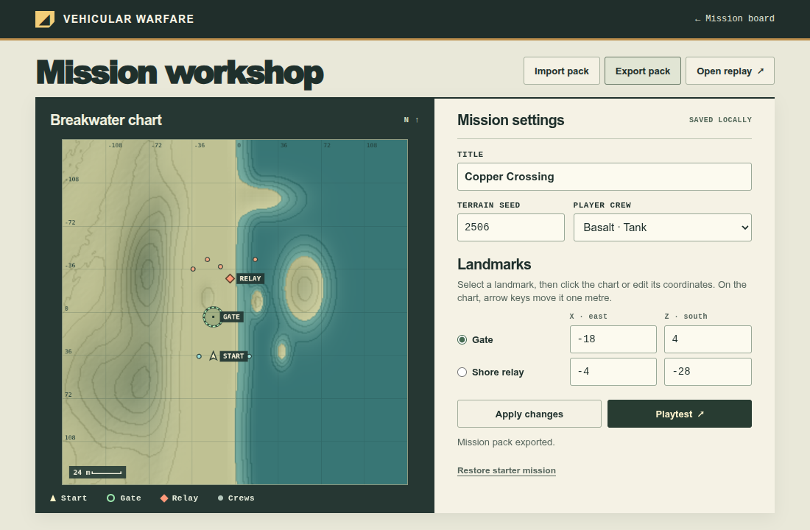

# VW-006 · Mission workshop verification

Import [Copper Crossing](copper-crossing.json) into **Mission workshop** to play the authored tank mission. To watch the recorded runs, use **Open replay** with the [victory](victory-replay.json) or [defeat](defeat-replay.json). The original music from the winning command stream is available as a [WAV recording](workshop-score.wav).



The reviewed base is `c1ec61a9f110f907cf1e557b85d7cc1f683e19c3`. All gameplay, validation, rendering, audio and acceptance drivers were exercised at `9506f890641fcc39ce5047feec4c47a11db499ad`. The following commit archives the results and clarifies two playback details in the user guide.

## From authoring to replay

The Chromium run entered from the mission board under a nested local HTTP path. It changed the title, crew and seed, placed the shore relay by clicking the chart, moved the gate one metre with a keyboard arrow and exported the accepted pack. It rejected a submerged relay, restored the starter, reimported Copper Crossing and reloaded the page. The draft survived. The editor also fit a 390-pixel viewport. [Editor screenshot at 390 pixels](01-workshop-narrow.png) · [Pack and editor contract](../../docs/CREATOR_SYSTEMS.md)

Copper Crossing uses seed 2506, a Basalt tank, a gate at [−18, 4] and a relay at [−4, −28]. The code created a fresh 120 Hz world on deployment. Pressing W and Space advanced the tank and fired cells. At the gate, the driver released W, held Shift and kept firing. Advancing with W alone in a second deployment led to destruction. [Live playtest](02-playtest.png) · [Victory](03-debrief.png) · [Defeat](05-defeat.png)

| Chromium result | End tick | Score | State digest | Ordered event digest |
| --- | ---: | ---: | --- | --- |
| Victory | 960 | 350 | `aa39340b` | `9d4a1d5d` |
| Defeat | 1,054 | 150 | `567c59c2` | `2f954672` |

The browser downloaded and verified both receipts. At tick 480 the state digest stayed `9e45b2a8` across the chase, gun sight and overhead views. Rewinding and seeking back to 480 reproduced that digest. The viewer replayed to the terminal receipt, rejected an altered event digest and reopened the original VW-005 tank victory at tick 1,149 with its original state `167150e6` and events `ce10fecb`. [Chase](04-replay-chase.png) · [Gun sight](04-replay-sight.png) · [Overhead](04-replay-overview.png) · [Chromium report](creator-browser.json)

The playtest cleared held inputs, froze time and released mesh buffers, audio and the animation loop on pause, blur and pointer unlock. The viewer also paused on blur with music enabled. Denying WebGL on reload opened the error panel. The driver observed 54 distinct local URLs and zero runtime or request failures. [Lifecycle, requests and recordings](creator-browser.json)

## Numerical acceptance

All 87 Node tests passed. Four separately authored layouts reached victory. A second Copper Crossing run reached defeat. All 35 timed seek destinations matched independent simulation from tick zero, including backward seeks. Separate limit tests used 14,400 command changes over 14,400 ticks in both a workshop recording and a VW-005 recording. Other fixtures covered invalid Unicode byte lengths, non-data properties, extra fields, nonfinite coordinates, disconnected gates, premature mission termination, cancellation and altered receipts. [TAP](node.tap) · [Authority tests](../../test/creator-authority.test.js) · [Maximum-length test](../../test/creator-limit.test.js) · [Raw measurements](creator-measure.json)

| Node layout | Crew | Outcome | Ticks | State digest | Ordered events |
| --- | --- | --- | ---: | --- | --- |
| Tidal Ledger | Helicopter | Victory | 907 | `c4aebfc7` | `33d84d21` |
| Copper Crossing | Tank | Victory | 1,022 | `c22af72f` | `758f66f5` |
| Salt Steps | Mech | Victory | 905 | `aa628125` | `deabd2a3` |
| Estuary Wake | Ship | Victory | 905 | `846d1c33` | `4b03c0f9` |
| Copper Crossing | Tank | Defeat | 1,054 | `d2459c26` | `e0544f81` |

Live browser key transitions can land on different ticks from the numerical controls. Each replay stores its canonical mission pack, exact command changes, source identity and two digests. The workshop source identity is `vw-006:057c8c012f5a1ec99b9bd86a64a3eb6416740e6466579d2b710d1c8b6aa98469`. The five earlier simulation identities and all historical simulation files matched the reviewed base. Rebuilding VANILLAJS v3.4.0 at `0cffbcfe2524bbf7f82190ef8ef0813aeb6bb466` reproduced all five vendored modules, the licence, notice and manifest byte for byte. [Provenance](provenance.json) · [Evidence checksums](SHA256SUMS)

## Reproduction

Serve the repository from its root with `python3 -m http.server 8080 --bind 127.0.0.1`. Open the local mission board and choose **Mission workshop**. The browser driver also exercises the game under the `/ridgefire/` path prefix. Raw simulator, browser and sampled audio timings have different measurement scopes. [Timings, resources and audio evidence](MEASUREMENTS.md)

```sh
output=$(mktemp -d)
python3 tools/identity.py --check
node --test test/*.test.js
node tools/measure.mjs > "$output/flight-measure.json"
node tools/measure.mjs creator > "$output/creator-measure.json"
CHROMIUM=google-chrome node tools/browser.mjs "$output/workshop" creator
CHROMIUM=google-chrome node tools/browser.mjs "$output/sable"
CHROMIUM=google-chrome node tools/browser.mjs "$output/routes" routes
CHROMIUM=google-chrome node tools/browser.mjs "$output/terrain" terrain
CHROMIUM=google-chrome node tools/browser.mjs "$output/tank" tank
CHROMIUM=google-chrome node tools/browser.mjs "$output/mech" mech
CHROMIUM=google-chrome node tools/browser.mjs "$output/naval" naval
CHROMIUM=google-chrome node tools/browser.mjs "$output/combined" combined
(cd evidence/creator-systems && sha256sum -c SHA256SUMS)
```

## Historical regression runs

All seven earlier Chromium suites ran on the same implementation SHA. Sable Valley, the land and naval sorties, and the combined encounter verified their original gameplay paths. The separate original flight benchmark also retained its 801-tick victory and digests `e97f4002` and `7aca9422`. [Flight benchmark](flight-measure.json)

| Standalone mission | Victory / defeat tick | Raw report |
| --- | ---: | --- |
| Sable Valley | 1,054 / 765 | [Run](sable-regression.json) |
| Cutbank Relay | 485 / 1,058 | [Run](tank-regression.json) |
| Glassworks Crossing | 1,153 / 1,135 | [Run](mech-regression.json) |
| Lantern Sound | 1,250 / 959 | [Run](naval-regression.json) |

Long Watch won at tick 8,542 and Frostline Run at 9,465. Chromium repeated each new receipt. Both original route files also passed the in-page replay checker. Node produced different state digests for these two Chromium recordings, as in the earlier same-runtime acceptance runs. The separate Long Watch exposure flight ended after 9 hits. [Route victories](routes-flights.json) · [Exposure](routes-exposure.json) · [Runtime](routes-runtime.json) · [Archived uploads](archived-routes.json)

WebGL, voxel and switching schedules reproduced the same tick-442 Sable victory with state `56d28634` and events `79014d08`. Breakwater Reach victory ticks were helicopter 1,095, tank 1,149, mech 820, ship 978. The exposed crew lost at tick 1,064. [Terrain parity](terrain-regression.json) · [Breakwater playthroughs](combined-regression.json)
