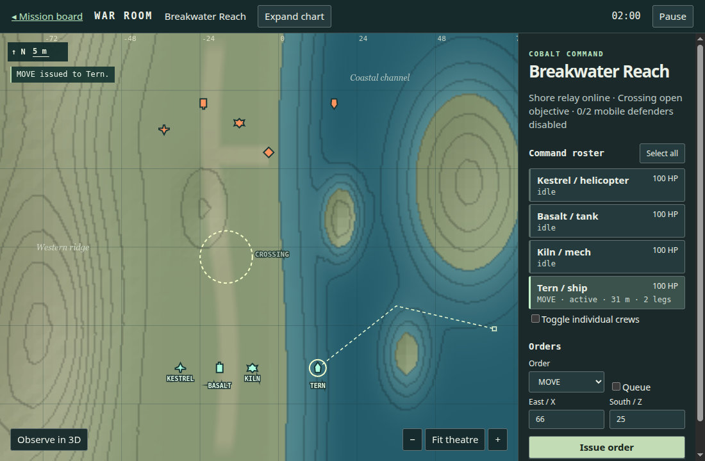

# Formation Intelligence acceptance

The tested implementation is `81d83e954451a07bd0412926a073bc0b9a0a9374`, based on v0.4.0. All 130 numerical tests passed, including a walking crew replanning around a friendly tank that stopped in its lane. The v0.4.0 simulation modules and source IDs are byte-identical to the released files.

On the default coast the cutter was ordered to (66, 25). The released direct controller grounded 31.99 m from the marker and reported blocked at tick 1,871. Formation routing chose a leg through (36, 18). Tern reached its destination afloat at tick 2,386, within 2.93 m. Both numerical runs used the original game roster, boat and combat solvers. The comparison includes real opponents.

Chromium used the mission board to deploy Formation Command, selected two crews and gave a shared move. It verified that both moved and received distinct slots, paused, and reopened their formation recording. A second deployment exercised the cutter detour. A final visit to the classic War Room reimported the archived v0.4.0 victory receipt.

The compressed reports include source and renderer identification, screenshots from the native run, in-browser admission / tick / frame samples and the numerical direct-versus-formation measurements. The numerical timing samples use 1,200 ticks after a common initial order. Divergent trajectories, casualties and contact work affect cost. Each class uses a bounded board search, and one stalled leg can trigger a new search. Routes can still report obstruction.

## Reproduce

~~~sh
python3 tools/identity.py --check
node --test test/*.test.js
node tools/formation-measure.mjs
out=$(mktemp -d)
python3 tools/package.py "$out/game.zip"
python3 -m zipfile -e "$out/game.zip" "$out/unpacked"
export RIDGEFIRE_WEB_ROOT="$out/unpacked/Vehicular-Warfare"
CHROMIUM_BACKEND=software node tools/browser.mjs "$out/software" formation
CHROMIUM_BACKEND=native node tools/browser.mjs "$out/native" formation
~~~

[Routing contract](../../docs/FORMATION.md) · [Tested ZIP and runtime digests](provenance.json) · [Numerical measurements](measure.json.gz) · [Native report](native.json.gz) · [SwiftShader report](software.json.gz)

