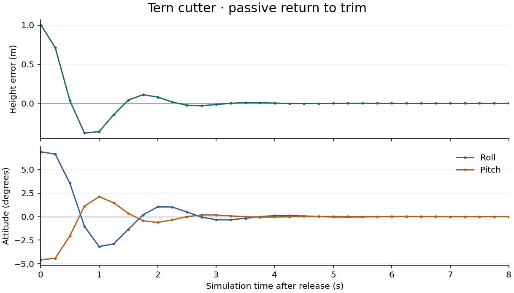

# VW-004 · Lantern Sound verification

The game, tests and acceptance drivers were exercised at `1daf1d2a7471926474852d8147423c216283c40b`, based on the reviewed Glassworks merge `f135b772dc9686b216f0401f42bf9da4849dbdc2`. The next commit adds the results in this directory.

## Play or reproduce

Serve the repository with `python3 -m http.server 8080 --bind 127.0.0.1`. Open `http://127.0.0.1:8080/` in Chromium and choose **Naval sortie → Cast off**. Sail ahead with W and use A/D for the rudder. Arrow keys move the deck mount independently. To reproduce the winning route, advance north with W and Space, disable the crossing patrol and shore station, and keep sailing to the green buoys. To reproduce the loss, advance with W alone. C switches cameras and P pauses. The debrief can save a replay. Open **Bridge controls & saved replays** to verify it locally.

```sh
output=$(mktemp -d)
python3 tools/identity.py --check
node --test test/*.test.js
node tools/measure.mjs > "$output/flight-measure.json"
node tools/measure.mjs naval > "$output/naval-measure.json"
CHROMIUM=google-chrome node tools/browser.mjs "$output/naval" naval
CHROMIUM=google-chrome node tools/browser.mjs "$output/mech" mech
CHROMIUM=google-chrome node tools/browser.mjs "$output/tank" tank
CHROMIUM=google-chrome node tools/browser.mjs "$output/sable"
CHROMIUM=google-chrome node tools/browser.mjs "$output/terrain" terrain
CHROMIUM=google-chrome node tools/browser.mjs "$output/routes" routes
```

## Does the hull float?

At rest the Tern draws 0.65 m and displaces 7.8 game volume units across six immersed columns. The numerical release started with the hull centre 1 m above trim, 0.12 rad of roll and −0.08 rad of pitch. With neutral controls it dropped below trim, rose and settled. After eight simulated seconds its centre was at 0.349991 m against a 0.35 m equilibrium, with 7.800107 units displaced. The plotted points come from the independent release in the naval measurement command. [Raw samples](naval-measure.json) · [Water and vessel contract](../../docs/NAVAL_WARFARE.md)



All 52 Node tests passed on v22.18.0. The vessel fixtures verified gravity on a dry hull, restoring forces on a submerged hull, lateral and longitudinal drag, coasting, signed rudder response and reverse motion. A shoal between the flotation points, a shallow shelf and the chart edge each stopped the hull. The driver could then reverse away. The mission fixtures verified same-tick water, terrain and actor contact ordering, an obstructed muzzle, own-bridge obstruction, sight loss and reacquisition, ship separation and independent damage to ship and shore. [TAP](node.tap) · [Vessel fixtures](../../test/vessel.test.js) · [Mission fixtures](../../test/naval-world.test.js)

## Playthrough and replay

| Seed 1404 run | Ticks | Score | State digest | Ordered event digest |
| --- | ---: | ---: | --- | --- |
| Node, advance and fire | 1,249 | 250 | `20a71959` | `e519319c` |
| Node, advance into patrol fire | 959 | 0 | `3308d4cc` | `2101dfcc` |
| Chromium, keyboard victory | 1,250 | 250 | `7cc2cb84` | `2b4ce92d` |
| Chromium, keyboard defeat | 959 | 0 | `82a402d5` | `fde03734` |

The Node victory reproduced on 30, 60 and 144 Hz display schedules. Both numerical outcomes replayed in Node and both browser outcomes replayed in Chrome. The file picker verified the downloaded win, SHA-256 `d01f456db81dd40a53c108eae3c84d8e2a29488adec55dcdac5bd34c87186dc0`. Browser input began after launch, producing distinct recorded command schedules. [Numerical events and commands](naval-outcomes.json) · [Downloaded browser replay](winning-replay.json)

In the first browser sortie, all six buoyancy points were wet at rest. Accelerating pitched the bow up. With the starboard rudder and port mount control held, hull heading reached +2.98°, mount bearing −41.54° and heel −1.87° at 3.81 m/s. The first shot in this run hit water at exactly the rendered elevation of 0 m. On restart the island hid the patrol at tick 1. The patrol was visible at tick 329. Accepted hits disabled it at tick 643 and the shore station at 1,236. The exit awarded the remaining 50 points at tick 1,250. The cutter finished with 60 health. [Raw Chromium report](naval.json)

[Briefing](01-lantern-briefing.png) · [Underway](02-underway.png) · [Water contact](03-water-contact.png) · [Channel engagement](04-channel.png) · [Shore station](05-shore-station.png) · [Victory](06-entrance-secured.png) · [Defeat](07-defeat.png)

The browser entered play from the mission board under a nested loopback path. It exercised keyboard and mouse controls, sound, a full restart, pause, blur, hidden-state notification, pointer unlock and an actual foreground-tab change. Across the paused observations the clock stopped, input cleared and the station released its mesh set, sound, animation frame and session listeners. Denying WebGL on reload displayed the error panel. All recorded requests stayed local and the driver observed zero runtime errors. [Requests and lifecycle samples](naval.json)

To verify the two numerical recordings, run this from the repository root.

```sh
node --input-type=module - <<'JS'
import {readFileSync} from 'node:fs';
import assert from 'node:assert/strict';
import {replayNaval,navalReceipt} from './sim/naval-world.js';
for (const run of JSON.parse(readFileSync('evidence/naval-warfare/naval-outcomes.json'))) {
  const world = replayNaval(JSON.stringify(run.receipt));
  assert.deepEqual(navalReceipt(world),run.receipt);
  assert.deepEqual(world.events,run.events);
  console.log(world.status,world.tick,run.receipt.stateHash);
}
JS
```

## Timing and limits

Chrome 158.0.8127.36, V8 15.8.62.31, ran WebGL1 at 1100 × 720 on an AMD Ryzen 9 5950X using ANGLE Vulkan SwiftShader software rendering. Pairs are p50 / p95 in milliseconds. Frames use RAF intervals, view CPU includes preparation and draw submission, and tick CPU measures one world step. The station retains up to 1,024 samples per metric. Zero reflects the timer resolution.

| Run | Frame samples | Frame interval | View CPU | Tick CPU | Peak live cells |
| --- | ---: | ---: | ---: | ---: | ---: |
| Browser victory | 620 | 16.7 / 16.8 | 0.3 / 0.4 | 0.1 / 0.2 | 4 |
| Browser defeat | 472 | 16.7 / 16.8 | 0.3 / 0.5 | 0.0 / 0.1 | 1 |

The first patrol damage observation submitted 68,700 vertices in 10 draws with 1,795,392 bytes of accounted geometry. The world caps actors at three, live cells at 12 and recent events at 96. The debugger reported 59,036,060 bytes of used JS heap after restart and 2,279,240 bytes after final teardown and forced collection. Those snapshots cover the page and debugger. The separate Node victory measured 67 / 172 microseconds per step over 1,249 samples, with four cells live at peak. [Raw browser measurements](naval.json) · [Raw Node timings](naval-measure.json)

The water is flat. Flotation uses six columns and bounded angles, and the seabed test uses a conservative envelope. Projectiles follow tick-length chords and ships have approximate hull and deckhouse hit boxes. The relay has a static hit box. Native GPU performance, physical speaker output, mobile controls and long-session allocation rates were **not run**.

## Regression and provenance

Glassworks completed victory and defeat at ticks 1,154 and 1,134. Cutbank completed both at 485 and 1,058. Sable Valley won at 1,088 and lost at 763. With fixed commands, WebGL, voxel and renderer switching all reproduced the same 442-tick Sable victory with state `56d28634` and event digest `79014d08`. [Mech](mech-regression.json) · [Tank](tank-regression.json) · [Sable](sable-regression.json) · [Terrain](voxel-regression.json) · [Flight measurement](flight-measure.json)

Long Watch won at tick 8,578 after 12 enemy launches. Frostline Run won at 9,391 after 17. Each recording verified in Chrome. As on the reviewed base, Node produced different digests for these two Chromium recordings. The exposed Long Watch flight ended after nine damaging hits at tick 1,633. All six Chromium suites exited successfully with zero recorded runtime errors. [Flight receipts and replay comparison](routes-flights.json) · [Exposure defeat](routes-exposure.json) · [Chromium runtime](routes-runtime.json)

Six archived Sable Valley, Cutbank and Glassworks wins and losses reproduced in Node with their recorded state and event digests. Their simulation source files matched the reviewed base. Lantern Sound has its own source identity, `vw-004:b79ed929ce6ea1bdd8e546a74c4a99fed87fc392d2078bfbdea3ce4a7df5e341`. [Archival replay verification](archived-replays.json)

The upstream VANILLAJS v3.4.0 tag resolved to `0cffbcfe2524bbf7f82190ef8ef0813aeb6bb466`. Regenerating the import closure in a temporary directory produced byte-identical copies of all five modules, LICENSE, NOTICE and the manifest. The manifest SHA-256 is `0608e182be0d55f1dcb2fcf92eae6e3078e704de8ef7fadcc0fb5ab933a61bef`. The Lantern terrain, geometry, sound and mission content are original to this repository. [Per-file receipts](../../vendor/vanillajs/provenance.json)
