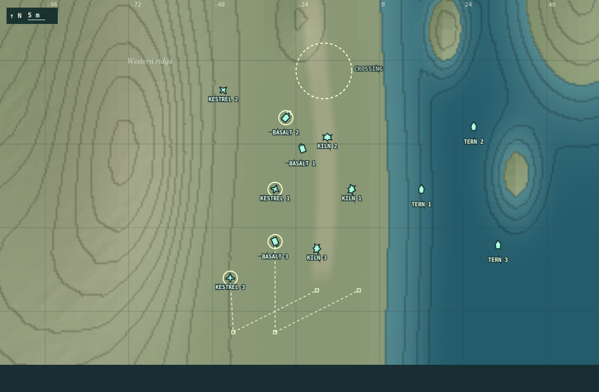

# Coordinated manoeuvre acceptance

The implementation at `c9827080dfce28e08ae6569f9e39087ff2c29bcc` passed the identity check and all 154 tests under Node 22.18.0. The restricted test runner initially reported `spawnSync python3 EPERM` when a test launched the identity checker. The complete suite then ran with subprocess permission. [Test output](node.tap.gz)

| Default coast on seed 2505 | Outcome | Tick | State digest | Event digest |
| --- | --- | ---: | --- | --- |
| Big Battle with explicit DEFEND and MOVE | Defeat | 14,400 | `1e02435e` | `0b073bec` |
| Doctrine scenario with the same two orders | Victory | 874 | `d96a489c` | `35cd09cc` |
| Fixture A with COVER and ADVANCE | Victory | 1,064 | `6c198010` | `aa4cbd69` |
| Fixture B with an additional FLANK and a different cover position | Victory | 3,568 | `f2aebb1c` | `9b54c928` |

In fixture A, Kestrel 1 waited until Basalt 2 reached its assigned cover slot. The aircraft began its ordered advance at tick 94. The tank launched shot 8 at tick 118, spending one round. That shot hit the relay at tick 239. The uncoordinated doctrine run launched the same shot, but its aircraft had already advanced 2.74 m south by tick 118. The coordinated aircraft had moved 0.06 m south by that tick. Waiting for cover delayed the coordinated victory by 190 ticks in this fixture. All four complete recordings reproduced within Node. [Raw orders, routes, positions, events and receipts](measure.json.gz)

In fixture B, the ordinary formation route took Basalt 3 via (−18, 66). Its alternate approach took the tank via (−30, 78), which it reached at tick 657. The tank arrived at its final slot by tick 2,674, within 1.65 m. Kestrel 3 arrived at its separate intermediate and final slots at ticks 517 and 1,002. Elsewhere on the board, the advance released at the cover wait limit. Basalt 2 fired while Kestrel 1 was travelling at 9.70 m/s at tick 368. The tank was disabled at tick 1,104. The numerical rejection fixture verifies an inland cutter destination produces an independent blocked result. [Scenario rules and reproduction commands](../../docs/OVERLORD_GROUPS.md)

Chromium 158 ran fixture B against the extracted ZIP with SHA-256 `49a1077e067c9f776f587efb136d10325b2c5ef577596719ebe9ae818e2e4602`. The browser drew the strategic map at tick 240 and reproduced its 3,568-tick victory with state digest `25a2fedb` and event digest `0e48db90`. The browser and Node have different digests for this recording. Verification scope is the original runtime. [SwiftShader and replay observations](software.json.gz)

## Cover reassignment correction

At the pre-review head `b1c089f`, replacing a covering crew’s task with another COVER at the same tick left the original advancing crew waiting. Both the identical replacement and a distant replacement at (−90, 90) reproduced the problem. Assigning another crew its own COVER correctly preserved the original wait. [Three submissions through the scenario API](review/before.tap.gz)

At `ad75fea30e5ec2ed496b213c30609d2c5639ed32`, ADVANCE tracks the particular accepted COVER assignment. Both replacements released the waiting unit on its next step. All three cases replayed, and all 157 Node tests passed. The numerical fixtures A and B again ended in victory at ticks 1,064 and 3,568. Their verified state / event digests were `83ca9541` / `aa4cbd69` and `f2aebb1c` / `9b54c928`, respectively. [Corrected cases](review/after.tap.gz) · [Full suite](review/node.tap.gz) · [Fixture traces and receipts](review/measure.json.gz)

Chromium 158 with SwiftShader exercised the extracted corrected ZIP, SHA-256 `bb3b4bb46ce22d8e0b2e0f69376ca5bf85f1cc089690bd22504c35ccfb11b0d2`. Its alternate-route recording reproduced the tick 3,568 victory with state / event digests `25a2fedb` / `0e48db90`. The corrected source identity is `vw-tact-003:fe43304618801b334cfb22dbbaa1445e339694b21d0d121a5e8b634f9a67f5bf`. [Packaged browser and runtime manifest](review/software.json.gz) · [Accepted route screenshot](review/01-section-routes.png)
