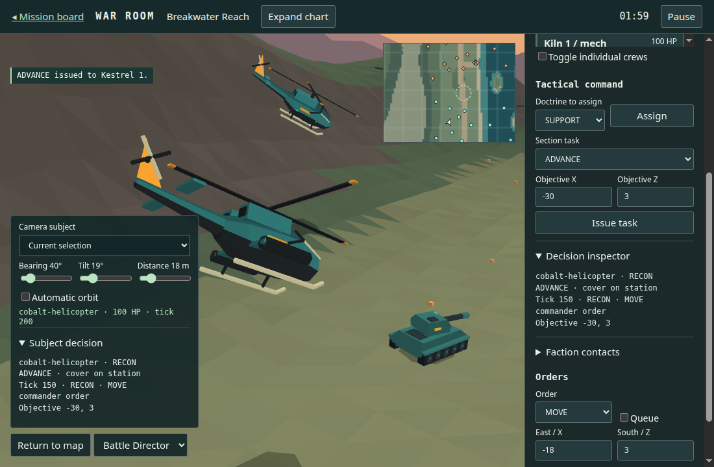

# Operation Overlord acceptance

The [offline ZIP](Vehicular-Warfare.zip) was built from `8ada33b9bbf5d2114f684c667aecad80855896bb` and has SHA-256 `ad77f65cc0117614d6181d836adfc6501480f2989d04d1df74075d309b005f90`. The ZIP passed its CRC check. Chromium compared all 103 served runtime files with their Git blobs. The runtime manifest digest is `bd4944ed54760d4efe3446f1c2f322f675d323a79ab6ad532d0c6e37971423c2`. The v0.5.0 base is `19b530b04692607f4dacc96e3f14525e3562aaa2`. The VANILLAJS v3.5.0 vendor tree and the historical source receipts match that base.

## Play the recorded operation

Extract the ZIP and serve its Vehicular-Warfare directory using `python3 -m http.server 8080 --bind 127.0.0.1`. Open the mission board in desktop Chromium and select **Operation Overlord · Tactical Intelligence**. To inspect the recorded outcome, use the briefing’s **Open replay** with the [native recording](native-recording.json) or [SwiftShader recording](software-recording.json). [Commander guide](../../docs/OVERLORD.md)

The Chromium driver selected two crews and assigned SUPPORT. It gave Basalt 2 a COVER order and Kestrel 1 an ADVANCE to a separate position. In the native run the advancing crew released at tick 94 with recorded reason “cover on station”. The covering crew fired shot 8 at tick 118. At tick 162 the driver observed that shot in the launch history, the advance still executing and the aircraft over one metre from its initial position. The aircraft had reported an Ember helicopter at tick 0. The driver entered Battle Director, opened the subject’s decision inspector, returned to the map, completed the operation and verified the downloaded recording through the briefing file input.

| Renderer | Victory tick | Reproduced state | Reproduced events |
| --- | ---: | --- | --- |
| RTX 5060 Ti | 1064 | `c334a225` | `e050ac0d` |
| SwiftShader | 1057 | `b1fec909` | `6fcc16ca` |

Both runs also inspected a verified frame, paused with mission audio active, restarted, lost focus, cancelled a captured pointer and lost the WebGL context. Each interruption stopped the tick, released the observer buffers and cleared the drag, scheduled frame and audio. Both drivers finished with zero recorded page exceptions or request failures. Browser command timings differed between runs. [Native observations](native.json.gz) · [Software observations](software.json.gz)

## Numerical and historical coverage

The final identity check and all 161 numerical tests passed. The time-limit defeat test assigned DEFEND to all twelve Cobalt crews, ran to tick 14,400 and verified the recording with survivors still short of the crossing. The formation regressions cover inaccessible slots, the validated alternate approach and replacement of a specific COVER assignment at the same tick. [Full test output](node.tap.gz) · [Section-level fixtures](../overlord-groups/README.md)

The extracted candidate reproduced all 107 distinct archive recordings from 204 occurrences. Chromium also reopened five original command downloads from War Room, Formation Command and Big Battle through the appropriate mission’s file input. [Archive catalogue](archives.json.gz) · [Command saves](overlord-legacy.json.gz)

The tested command sequences and short profiling windows establish same-runtime replay and performance on the tested desktop. The opening deployment has widespread sight. The island fixture exercises a concealed contact. The planner has two alternate markers per crew, can report a blocked route, and waiting for cover delayed victory by 190 ticks in the measured group fixture. [Perception checks](../overlord-intel/) · [Paired timings, resource counts and digests](PERFORMANCE.md)

## Reproduce

~~~sh
python3 tools/identity.py --check
node --test test/*.test.js
node tools/overlord-measure.mjs
out=$(mktemp -d)
python3 tools/package.py "$out/Vehicular-Warfare.zip"
python3 -m zipfile -e "$out/Vehicular-Warfare.zip" "$out/unpacked"
export RIDGEFIRE_WEB_ROOT="$out/unpacked/Vehicular-Warfare"
CHROMIUM_BACKEND=native node tools/browser.mjs "$out/native" overlord
CHROMIUM_BACKEND=software node tools/browser.mjs "$out/software" overlord
node tools/browser.mjs "$out/archives" archives
node tools/browser.mjs "$out/legacy" overlord-legacy
~~~
