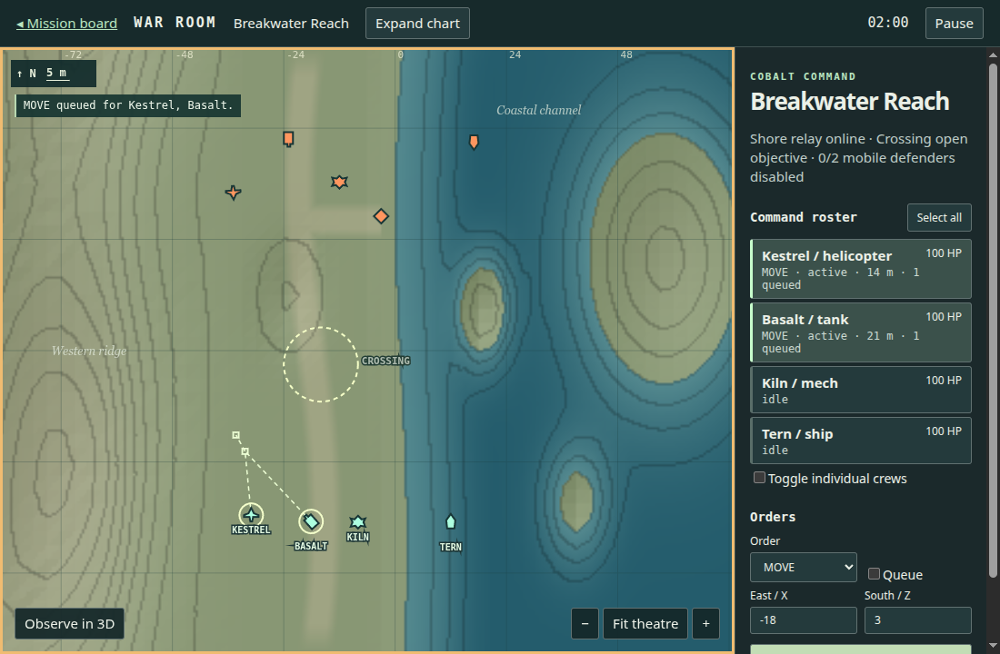
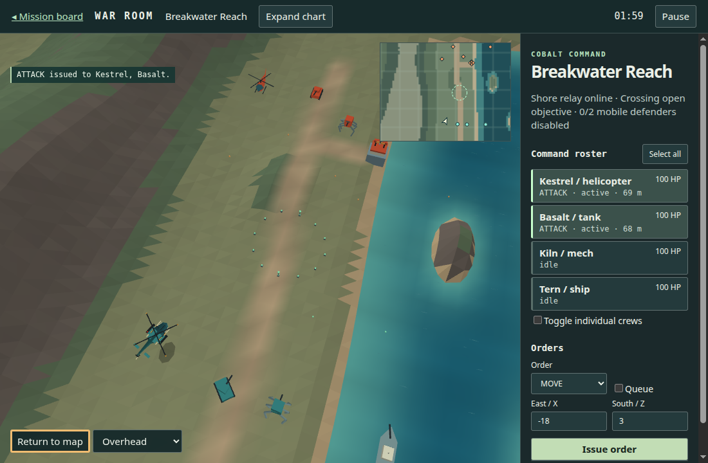

# The War Room · packaged acceptance

Tested revision **80e0b0aac2d737a3a5c0a05f5522611b8d2aad86**, stacked on Command Authority **3f370a4ed4a3cdd074a179cfd68b8ba7cd58175c**. The ZIP comment identifies the tested commit and its SHA-256 is `27ec8fa1ae0227678c881ee466dedd67d90e54cb839f49d5bcd232d827d9a2b6`. The evidence commit adds the results to the pull request.

[Download the tested offline game](Vehicular-Warfare.zip). Extract it and serve the Vehicular-Warfare directory locally with `python3 -m http.server 8080 --bind 127.0.0.1`. Open localhost port 8080, choose War Room on the mission board and deploy.

## Reproduce at the tested revision

~~~sh
out=$(mktemp -d)
python3 tools/identity.py --check
node --test test/*.test.js
node --test test/command-world.test.js test/strategic-map.test.js
python3 tools/package.py "$out/Vehicular-Warfare.zip"
python3 -m zipfile -e "$out/Vehicular-Warfare.zip" "$out/unpacked"
export RIDGEFIRE_WEB_ROOT="$out/unpacked/Vehicular-Warfare"
CHROMIUM_BACKEND=software node tools/browser.mjs "$out/software" war-room
CHROMIUM_BACKEND=native node tools/browser.mjs "$out/native" war-room
~~~

The browser driver checks the extracted runtime against Git before launching. In both runs it starts at the mission board, uses pointer and keyboard selection, assigns and recalls a group, issues real orders, observes accepted movement, switches cameras and returns to the map. It tests an out-of-bounds waypoint and a stale designation of a living, concealed hostile. After restart the commander issues an ATTACK and a queued MOVE, saves the victory through the debrief and reopens the downloaded JSON through the file input.

The lifecycle sequence exercises pause, blur, visibility change, pointer cancellation, WebGL context loss, restart and navigation back to a released mission. Blur and hidden-state notifications in the War Room driver are dispatched events. The renderer loses its actual WebGL context. The numerical suite passes 124 tests, including both map projection tests and the command authority tests. [Complete TAP](node.tap) · [Focused TAP](strategy.tap)

All seven original missions and the workshop passed packaged Chromium acceptance. The first Breakwater run lost its Chromium inspector connection after the four crew victories. A fresh-profile rerun completed the defeat and lifecycle checks as well. The historical results retain the interrupted log. The extracted archive reproduced 24 distinct recordings from the v0.3.0 tactical-display browser evidence and the separate 107-recording historical catalogue. [Historical runs and replay results](historical/summary.json)

[Camera and map measurements](PERFORMANCE.md) compare the two qualified rendering backends separately. [Command authority evidence](../command-authority/README.md) covers movement and collision, the full encounter, order admission cost and a paired numerical comparison with v0.3.0. Eight mobile units and the existing shore relay are the tested roster. Movement uses direct waypoint legs and can stop blocked on terrain or another unit.

## Recorded result

On both backends the all-crew ATTACK was admitted at tick 2 and Kestrel’s queued MOVE to (−16, 3) at tick 8. Victory at tick 1,325 reproduced state `7aa1daf8` and events `9fd488bb`. The SHA-256 of the downloaded JSON was `8b7f8e2470fc9e3a869ed971bd1283359d11d2e121ffb69d562bfeaa4aa34e23`. [Browser replay](browser/native-replay.json)

